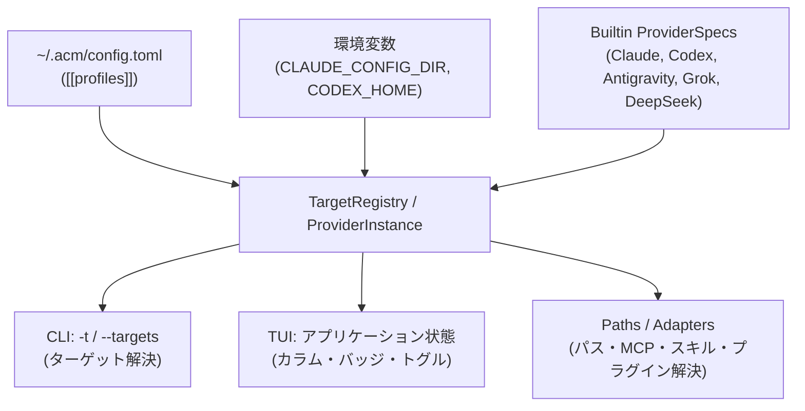

# マルチプラン・マルチプロファイル対応設計書（Proposal）

## 1. 背景と課題

### 1.1 ユーザー環境の実態
現在、Claude Code と OpenAI Codex を Team plan と Personal plan の 2 つのアカウント/プランで分離・運用するケースがあります。
具体的には以下のような運用構成です：

| ツール | プラン | ホーム/設定ディレクトリ | MCP/設定ファイル | 起動方式・環境変数 |
| :--- | :--- | :--- | :--- | :--- |
| **Claude Code** | **Team** (標準) | `~/.claude/` | `~/.claude.json` | `claude_team` (`env -u CLAUDE_CONFIG_DIR`) |
| | **Personal** | `~/.claude-personal/` | `~/.claude-personal/.claude.json` | `claude_personal` (`CLAUDE_CONFIG_DIR=~/.claude-personal`) |
| **OpenAI Codex** | **Personal** (標準) | `~/.codex/` | `~/.codex/config.toml` | `codex_personal` (`env -u CODEX_HOME`) |
| | **Team** | `~/.codex-team/` | `~/.codex-team/config.toml` | `codex_team` (`CODEX_HOME=~/.codex-team`) |

※ `~/.config/agent-quota/config.toml` においても、同様のアカウントキー体系（`claude_account` / `codex_account`）が既に採用されています。

### 1.2 現状の acm の課題
- 現在の `acm` は 5 つのプロバイダ（`Claude`, `Codex`, `Antigravity`, `Grok`, `DeepSeek`）を 1 インスタンスずつのみ想定。
- `~/.claude-personal` や `~/.codex-team` のディレクトリは `acm` の管理対象外となっており、個別のアカウントへスキルや MCP、プラグインを配る・診断することができない。

---

## 2. 設計の基本原則（一般ユーザーへのゼロインパクト）

> [!IMPORTANT]
> **「他の、普通に使っている人が一切困らないこと」を最優先原則とする**
> 1. **完全な後方互換性**: 設定ファイルに変更がない場合、これまで通りの標準 5 ターゲット（Claude, Codex, Antigravity, Grok, DeepSeek）が全く同じ挙動で動作する。
> 2. **オプトインのプロファイル拡張**: 追加のアカウントや別ディレクトリ運用は、`~/.acm/config.toml` で明示的に定義した場合にのみターゲット候補として有効化される。
> 3. **標準ツールの公式環境変数の尊重**: 設定で定義されていない場合でも、シェル上で `CLAUDE_CONFIG_DIR` や `CODEX_HOME` が一時的にセットされていれば、標準ターゲットのパス解決時にそれを透過的に尊重する。
> 4. **一括配布と個別配布の両立**: `-t all` で追加プロファイルを含めて一括配布できるようにすると同時に、`-t claude-personal` のように特定アカウントにのみ配る運用も可能にする。

---

## 3. 設定ファイル仕様 (`~/.acm/config.toml`)

一般ユーザーは何も書く必要はありません。マルチプラン運用を行う場合のみ、`profiles` セクションを追加します。

```toml
# ~/.acm/config.toml
catalog_dir = "~/Code/Tools/agent-catalog"

# 必要に応じて default_targets に追加プロファイルを含められる
default_targets = [
  "claude",           # Claude Team (標準)
  "claude-personal",  # Claude Personal
  "codex",            # Codex Personal (標準)
  "codex-team",       # Codex Team
  "antigravity",
  "grok",
  "deepseek"
]

# --- マルチプロファイル定義 (オプトイン) ---

[[profiles]]
id = "claude-personal"
provider = "claude"
display_name = "Claude Personal"
short_code = "cp"
tui_key = "P"
home_dir = "~/.claude-personal"
# mcp_config は省略可能（省略時は <home_dir>/.claude.json）
# skills_dir も省略可能（省略時は <home_dir>/skills）
# plugins_dir も省略可能（省略時は <home_dir>/plugins）

[[profiles]]
id = "codex-team"
provider = "codex"
display_name = "Codex Team"
short_code = "xt"
tui_key = "T"
home_dir = "~/.codex-team"
# mcp_config は省略可能（省略時は <home_dir>/config.toml）
# skills_dir も省略可能（省略時は <home_dir>/skills）
```

### パスの解決ロジック（デフォルト値とオーバーライド）
- `home_dir`: 指定されたパスをチルダ展開。
- `mcp_config`:
  - Claude: `<home_dir>/.claude.json`
  - Codex: `<home_dir>/config.toml`
- `skills_dir`: `<home_dir>/skills`
- `plugins_dir`: `<home_dir>/plugins` (Claude の場合)

---

## 4. アーキテクチャ設計と内部データ構造



### 4.1 データ構造の拡張案

```rust
// ターゲットを一意に識別する識別子（enum または ID構造体）
#[derive(Debug, Clone, PartialEq, Eq, Hash, Serialize, Deserialize)]
pub struct TargetId(pub String);

// 実行時の解決済みターゲットインスタンス
#[derive(Debug, Clone)]
pub struct TargetInstance {
    pub id: TargetId,                   // "claude", "claude-personal", "codex-team" など
    pub provider: TargetName,           // 基底プロバイダ (Claude, Codex, ...)
    pub display_name: String,           // "Claude Personal"
    pub short_code: String,             // "cp"
    pub tui_key: Option<char>,          // 'P'
    pub is_default_instance: bool,      // 標準ターゲットかどうか
    pub home_dir: PathBuf,              // ~/.claude-personal
    pub home_mcp_config: PathBuf,       // ~/.claude-personal/.claude.json
    pub home_skills_dir: PathBuf,       // ~/.claude-personal/skills
    pub home_plugins_dir: Option<PathBuf>,
}
```

### 4.2 修正対象ファイルと変更点

1. **`src/providers.rs` & `src/types.rs`**:
   - `TargetName` はプロバイダ種別（プロトコル・振る舞い）の定義として維持。
   - `TargetRegistry` を追加し、ビルトイン 5 種 + `config.toml` の `[[profiles]]` を一元ロード。
   - `TargetName::from_str` または `TargetRegistry::resolve` でエイリアスおよび登録済み profile id（`claude-personal`, `codex-team` など）を認識。

2. **`src/paths.rs`**:
   - `get_agent_skills_dir`, `get_agent_mcp_config_path`, `get_agent_plugins_dir` にプロファイル情報を渡せるようにする。
   - プロファイル未指定時（標準ターゲット）:
     - Claude: 環境変数 `CLAUDE_CONFIG_DIR` があればその配下を参照、なければ `~/.claude`。
     - Codex: 環境変数 `CODEX_HOME` があればその配下を参照、なければ `~/.codex`。
     - ※ これにより、シェル関数 (`claude_personal`) 実行時にも自然に連動。

3. **`src/adapters/mod.rs` & CLI Delegation**:
   - Claude のホーム MCP 操作は `claude mcp add` コマンドに委託される。
   - `claude-personal` プロファイルの MCP 操作時は、環境変数 `CLAUDE_CONFIG_DIR="~/.claude-personal"` を付与して `claude mcp` を実行。

4. **`src/core/doctor.rs`**:
   - 診断対象に登録済みプロファイルを自動的に含める。
   - `~/.claude-personal/skills/` や `~/.codex-team/skills/` の Broken Symlink を自動検知し、`acm doctor --fix` で修復可能にする。

5. **`src/tui/`**:
   - プロファイルが登録されている場合、テーブルのターゲットカラムにバッジ（`cl`, `cp`, `cx`, `xt`, `ag`, `gk`, `ds`）を表示。
   - フッターのトグルキーも登録キーを反映。

---

## 5. 次の実装エージェント向け作業手順

### Step 1: 設定パースと Registry の作成
- `src/paths.rs` の `read_acm_config` または専用モジュールで `[[profiles]]` をデシリアライズ可能にする。
- `TargetRegistry` を実装し、未設定時はビルトイン 5 ターゲットのみ、設定時はプロファイルを追加。

### Step 2: パス解決のプロファイル・環境変数連動
- `paths.rs` 内のパス解決関数を `TargetInstance` 対応にする。
- 単一の Claude/Codex 呼び出し時に `CLAUDE_CONFIG_DIR` / `CODEX_HOME` を尊重するフォールバックを入れる。

### Step 3: CLI オプションとアダプター対応
- `-t` 引数で `claude-personal` や `codex-team` を指定可能にする。
- Claude CLI Delegation 時に該当プロファイルの `CLAUDE_CONFIG_DIR` をコマンド実行環境変数へ設定。

### Step 4: Doctor と TUI の追従
- `acm doctor` が全登録プロファイルのスキル・プラグイン symlink を診断・修復できるようにする。
- TUI でプロファイル列の表示とトグルができるようにする。

### Step 5: テストスイート拡充と実機検証
- 既存 75 件のテストが 1 件も壊れないことを保証 (`cargo test`)。
- プロファイル設定時の追加テスト（`tests/profiles_test.rs` など）を作成。
- ユーザー環境（`~/.claude-personal`, `~/.codex-team`）での実機テスト（`--dry-run` 等）。
